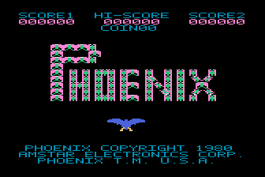
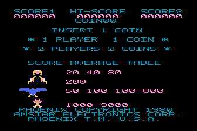

# Phoenix5200 release candidate 3 (v0.31)

Phoenix for an NTSC Atari 5200 with 16 KiB RAM. This 256 KiB CAR type 73 cartridge includes the repeating five-wave game: two small-bird waves, two large-bird waves and the mothership, followed by harder cycles.

[Download Phoenix5200.car](https://raw.githubusercontent.com/RobertDupuy/Phoenix5200/main/Phoenix5200.car) · [Download source](https://github.com/RobertDupuy/Phoenix5200/archive/refs/heads/main.zip) · [Previous published release candidate](https://github.com/RobertDupuy/Phoenix5200/releases/tag/release-candidate-2)

The cartridge in this checkout is the new candidate. The existing `release-candidate-2` tag and release asset remain unchanged. Rebuild with `LLVM_MOS=/path/to/llvm-mos python3 tools/build.py`; the result is `build/Phoenix-First-Flight.car`.

## Artwork credit

Hand-drawn Atari 5200 artwork by **T1X**.

## Changes in v0.31

Both large-bird waves now start with **seven birds**. The mothership has **five escorts**, including replenishment after the flock is destroyed. Existing movement, fast-mode thresholds, safe respawns, sound and T1X's sprite pixels are retained.

Four drawing optimizations make room for the added enemies:

- Reuse each display buffer's unchanged adult-bird color schedule. Moving eggs and shield/death color transitions still rebuild it when required.
- Clip old bird footprints once per sprite when clearing screen edges.
- Copy only the 26–37 populated mothership character shapes instead of all 64 slots.
- Precompute foreground transparency masks in ROM instead of recalculating them for every drawn pixel byte.

Identical seven-bird/five-escort CPU fixtures use 7.4% less large-bird drawing work and 16.2% less mothership drawing work than the previous renderer, with zero pixel or raster-schedule differences. In 1,200-frame NTSC runs, large waves averaged 20.47 and 19.92 rendered frames/s; the five-escort mothership averaged 17.98. Simulation remained about 61 Hz. All runs recorded zero audio underruns, missing audio updates, late vertical interrupts or glyph allocation faults.

Validation includes 272 matched rendering scenes, 200 actual ANTIC raster comparisons, 276 source-artwork checks, 411 campaign checks, fifth-escort collision/replenishment checks, and 256 death/respawn cases covering zero through seven survivors. The tests use original-BIOS Altirra emulation; no physical-console test is claimed. Artificial cold-cache stress scenes can take more than four video frames; this is not a fixed-frame-rate engine. Detailed measurements and scope are in `Phoenix5200-Performance-v031.txt` and `evidence/v031/`.

Cartridge SHA-256: `b701ec0da33148052e4aa484d121143327b9b7c191f6c90967d463c400c798e9`.

Earlier sections below describe their original revision-specific packages.

## Changes in v0.30 (historical)

Corrects the small birds' northwest return animation. The four leftward-return shape slots now use horizontally reflected copies of the supplied right-facing frames. Their original animation phases, movement paths and positioning rules are retained. The rightward sequence and every other sprite pose are unchanged.

Both wave 1 and wave 2 passed all sixteen direction/phase cases. Eight source-pose checks verify the complete left/right sequences; 276 artwork checks and 1,168 renderer scenes also pass. Only shape slots 208, 212, 216 and 220 differ from v0.29. All console assembly sources are unchanged. The existing six large birds and four mothership escorts remain; the arcade's large-bird waves use eight birds. The cartridge remains 256 KiB, CAR type 73.

Current checks: `evidence/v030/`. The v0.29 scanline corrections are retained.

## Changes in v0.29 (historical)

Corrects missing scanlines and color strips in both large-bird waves. Font changes now reach ANTIC before its next character fetch. Raster events are prepared in the back buffer, keeping the interrupt short; palette changes at the last scanline of a character row no longer collide with the next font change. Egg colors and the shield's top edge also switch on time. The supplied sprite pixels, movement rules, sound synthesis and 256 KiB cartridge format are unchanged.

The final cartridge passed 400 sampled-frame comparisons across both large-bird waves, checking the full 200-line playfield with zero missing, extra or wrong-color pixels outside occupied hardware sprites. Each wave ran for 1,400 video frames with no late VBI, layout faults or missing audio updates. All twelve shield/wave combinations and four mothership alien poses also passed actual-raster checks. Evidence and exact test scope are in `evidence/v029/` and `Phoenix5200-Artwork-Checks.txt`.

## Changes in v0.28 (historical)

The supplied purple creature now animates inside the mothership cockpit. All four original 8-by-16 frames are used, without stretching or redrawing. The score explanation uses the same alien artwork. Cockpit collision and victory rules remain unchanged, and the v0.25 bird-hit explosions restored in v0.27 remain in place.

The shield now surrounds the player ship. Its white, yellow, and red pixels remain visible inside all four supplied shield poses. The three player graphics layers are reused for the alien above scanline 192 and restored for the player below it; the alien's colors do not recolor the mothership hull.

The cartridge remains 256 KiB, CAR type 73, with four escorts. v0.28 verification is under `evidence/v028/`; earlier evidence retains its own cartridge hashes. Testing uses original-BIOS Altirra emulation, not physical hardware.

## Changes in v0.27 (historical)


Restores the v0.25 bird-hit explosion, including all eight animation states and their palette flags. The purple creature in the supplied GIF's seventh comparison row was incorrectly assigned to this effect in v0.26; it is now unassigned and retained with the source artwork for later identification.

The 59 other supplied frames remain in use. Bird poses, large-bird birth/flight, the player ship, shield, yellow player-death explosion, title and score artwork are unchanged. Sound and gameplay code are unchanged. The corrected cartridge remains 256 KiB, CAR type 73.

Current correction checks are in `evidence/v027/`. The v0.26 evidence below is historical and refers to its own recorded cartridge hash.

## Changes in v0.26 (historical; purple-creature assignment corrected in v0.27)

The user-supplied **right-hand Atari 5200 artwork** replaces the previous converted bird art. All 63 supplied frames are used: 23 large-bird frames, 28 small-bird/hit frames, four player frames, four shields, and four yellow explosions. The left-hand 7800 images are not used for game pixels.

The import removes only the GIF capture's uniform 4-by-2 display zoom. It preserves each logical pixel and color region, with no smoothing, symmetry edits, stretching, or invented intermediate poses. Existing animation states select the supplied poses; transparent margins are translated to the existing drawing origins. The wing-damage states remove the appropriate wing from the supplied full-spread frame because separate damaged frames were not supplied.

The player uses three PMG color planes, including the supplied yellow pixels. Its former extra PMG bomb is rendered through the existing software projectile path, retaining its position and collision rules. The shield remains 16 by 32 logical pixels. The yellow explosion is centered on the raised ship. The title and score pages use the new gameplay art; PHOENIX retains the requested pink wings/green centers, tall P, and normal letter spacing.

The physical GTIA palette supplies the colors. Large-bird birth and adult palettes change at their exact raster boundaries; the adult sprite uses cyan, yellow-green, and magenta. Small hit effects share the wave's playfield palette. Source RGB crops and their provenance remain intact in `src/supplied-5200/`.

Display interrupts are emitted only for actual color changes and font boundaries. Large-bird stages buffer four audio frames (one more than previously) to cover the extra art/color work. The v0.25 sound synthesis, explosion envelope and mixing are retained. The cartridge remains CAR type 73, 256 KiB, with four mothership escorts.

Rebuild with `LLVM_MOS=/path/to/llvm-mos python3 tools/build.py`. Python needs Pillow and NumPy. Current artwork and validation details are in `evidence/v026/`; historical sound investigations remain included. No physical-console test is claimed.

## Changes in v0.25 (historical)

The gunshot no longer replaces the player explosion's fading low rumble. The arcade sums both noise paths. This build keeps the low blast and puts the overlapping shot on an idle POKEY voice, preserving any active music and bird tone. The shot's noise clock now accounts for both active capacitor levels during that overlap.

The previous controller recording lost the low blast from 0.4005 to 0.5674 seconds after death. The same controller run on this build has no such interruption. The 12-second `Phoenix5200-Explosion-Comparison.mp4` plays original-ROM MAME, v0.24 and v0.25 with the burst loudness matched. Its port clips replay the same captured arcade control writes through the real cartridge audio code and native Altirra POKEY; separate live recordings verify integration. Unprocessed recordings and traces are in `evidence/current/`.

This fixes a verified mixing error. The isolated blast's noise setting and fade are unchanged from v0.24, and there is no claim of a complete perceptual match. The arcade reference is MAME, not a physical cabinet recording.

The exact release passed 200 envelope/gate cases, all 16 voice-busy combinations, real death/shot overlap, 4,200 tune ticks, 1,744 pitch cases, 8,192 large-bird cadence checks, 2,048 formation cases, five-wave player-death and mothership duration checks, and 411 campaign checks. A 39.52-second controller-only recording covered death, respawn and wave two, with no missed audio updates, active-play underruns, late VBI or allocation faults. No new full-game completion or hardware test is claimed.

Still CAR type 73, 256 KiB, four escorts. Player blast gate stays 16 ticks; mothership stays 64. Historical evidence is retained under its original version.

## Changes in v0.24 (historical)

Corrects the player-ship explosion trigger from 64 ticks to the arcade's 16 ticks (about 0.262 seconds before the decay). The mothership retains its 64-tick trigger. Music, noise settings, fade tables, graphics and gameplay are unchanged.

Three player deaths recorded directly from original-ROM MAME gameplay all held the explosion control for 16 writes, about 0.26216 seconds. The actual ship-damage entry point now passes the correct event duration to the sound dispatcher. A sweep of 24 POKEY noise settings found the existing mode/divider closest in frequency balance; it is retained.

This exact cartridge passed all five ship-wave event checks, the real mothership collision/duration check, sound regressions and 411 campaign checks. Its 39.52-second controller-driven Altirra recording included death, respawn and wave-two entry, with no missing sound updates, active-play underruns, late VBI or allocation faults. No physical-console test or new full-game completion is claimed. The sound is still a POKEY approximation; only the duration correction is released here.

Current evidence is under `evidence/current/`; v0.23 evidence is under `evidence/v023/`. The noise sweep compares isolated ship deaths with three native MAME gameplay recordings. The gameplay recording also retains any overlapping shot sounds; that overlap is unchanged in this release.

## Changes in v0.23 (historical)

The arcade shield stops the opening music; the recorded MAME input trace and original ROM confirm this. Music cancellation by shield, bird-hit sounds and the phase timeout is preserved. The tentative uninterrupted-music change was reverted before publication.

The ship/mothership explosion now retains eight-bit envelope precision until conversion to POKEY volume. This restores the tail that previously died away too soon. Frequency, peak volume and attack/release constants are preserved. The sound remains a POKEY approximation.

The final 39.52-second controller-driven Altirra recording includes an explosion, respawn and wave-two entry with no missed sound updates, active-play underruns, late VBI or graphics allocation faults. Before/reference/after explosion WAVs and the live recording are in `evidence/current/`. See `Phoenix5200-Sound-Study.txt` for scope and limitations.

## Changes in v0.22 (historical)

Fixed the gameplay sound dispatcher after controller-driven playback exposed errors missed by v0.21's isolated sound tests.

- Large birds now pulse at the recovered arcade cadence. The old code tested the incremented counter instead of the previous value, so its pulse never began.
- Small-bird diving sound uses the animation shape byte, as the arcade does. Formation birds no longer trigger it merely by being below a screen height.
- Bird sound stops during cleared-wave waits and wipes. Those transitions queue six audio frames to cover stage setup; a fixed-bank fallback fades a stalled voice instead of holding it indefinitely.
- Firing/death noise borrows an idle channel instead of erasing the large-bird pulse. The four-channel limit still applies when every musical/effect voice is occupied.
- Mothership arrival modulation advances with its descent timer. The entry voice is quieter and two octaves lower to avoid the sharp POKEY squeal. This is an intentional timbre compromise.
- Shield reset now reloads both buffers' artwork despite stale metadata left by another stage. The four original shield poses and their dimensions are unchanged.

A 238.54-second controller-only Altirra run played all five stages, including wave clears, mothership entry/combat, death and restart. It had no missing audio updates, no active-play queue underruns, no late VBI and no graphics allocation faults. The player did not defeat the mothership in this run; after restarting it reached wave three. All four shield poses passed a separate controller-driven, pixel-level silhouette check. No physical-console test was performed.

The v0.22 study is archived at `reference/audio-study/Phoenix5200-Sound-Study-v022.txt`; its evidence is in `evidence/v022/`. Historical v0.21 evidence is retained in `evidence/v021/`; it does not establish that its live dispatcher was correct.

## Changes in v0.21 (historical)

Sound was compared with the recovered MAME-derived Phoenix circuit and music model, using identical control events and actual Altirra POKEY recordings. Its original study is archived at `reference/audio-study/Phoenix5200-Sound-Study-v021.txt`; the isolated comparison WAV files are in `evidence/v021/audio`.

- High bird whistles use POKEY's independent fast clock, reducing pitch stair steps. Worst error in the 132 tested high-clock cases falls from 13.28% to 0.49%.
- Firing now follows the arcade's rising and quickly releasing capacitor envelope. Death noise has its own deeper spectrum, sustained body and release tail.
- Large-bird siren volume follows the arcade filter's frequency response. Its exact filtered waveform remains beyond this four-channel arrangement.
- Shield activation, bonus-life, mothership arrival and armor-impact sound sequences are present. Original opening/victory notes and timing are retained.
- The mothership receives six buffered sound frames; other stages retain three. Both 600-frame mothership runs now publish sound on every video frame, with no gaps.
- Gameplay stars are dark blue ($82). They remain static. Small-wave red effect/shield accents share pink to free that playfield color; player colors and large-bird palettes are preserved. Stars are hidden behind occupied foreground cells.
- The ship appears after the initial mothership descent. Movement, fire and shield input are blocked until the first combat frame is displayed.
- Four replenishing escorts remain. Fast mode still starts below three survivors. The rejected six-escort trial and its separate cartridge hash are preserved in `evidence/v021-trials`.

The cartridge remains 256 KiB. Title artwork and spacing are unchanged.

## Changes in v0.20

Corrected a skipped reset after death in the first and second small-bird waves. The resume routine now explicitly jumps to the formation initializer in its separate ROM section; previously it fell into the player movement routine and left attackers at the new ship's position.

Surviving small birds now return to their original formation with fresh movement state. Score, wave, difficulty and the number remaining are preserved. The large-bird reset from v0.19 is retained, and no extra invulnerability is added.

## Changes in v0.19

After a death in either large-bird wave, the surviving flock restarts as eggs in the original arcade formation. The number remaining, score, wave and difficulty are preserved. Scrolling, movement timers and wing damage reset; both screen buffers discard the old attackers. No additional invulnerability is added.

The reset follows arcade routines $0BA0 and $32B0: clear the bird-layer scroll and reload only the remaining birds from the tail of the original formation table. Zero survivors remain zero if the last bird is destroyed as the player dies.

## Changes in v0.18

- GAME OVER flashes for three seconds. Fire cannot restart during that interval; afterward, release fire and press again to restart.
- Restart blanks the display, clears both screen buffers and restores the display only after the first complete new frame. Old mothership tiles no longer appear during the redraw.
- The mothership uses the arcade's separate particle burst and pink core animation, followed by the red bonus and scrolling starfield. The bonus stays in its original screen position. The original 96-tick destruction and 64-tick award sequence are retained.

The animation uses the original particle and core tables, with all 63 visual snapshots and no vertical compression. Horizontal pairs are quantized for the Atari display; red particles share pink because of the available playfield colors.

`Phoenix5200-Preview.mp4` remains the v0.18 video; it does not demonstrate the v0.19/v0.20 flock resets. It is a 21-second Altirra capture of staged victory and game-over/restart tests. Its scene setup uses RAM fixtures; the full controller-only completion test is recorded separately in the evidence. Video audio is the game's native output with a 6 dB volume increase.

## Changes in v0.17

Equal three-pixel gaps between all seven letters. P has one-pixel horizontal gaps after its first and second birds only. Existing one-pixel gaps within H, O and E remain.

## Changes in v0.16

- The shield uses all 32 original arcade rows again. Removing the old 24-row vertical compression restores its round outline. All four animation frames fit within the screen and clear completely on expiry.
- H, O and E in the bird-built title have one empty native pixel column between horizontally adjacent birds. The original gameplay sprites, pink wings, green centers, tall P and flat large bird are retained.


## Changes in v0.15

- The ship is eight pixels higher. Its shots, shield, collision checks and explosion move with it.
- A small bird returning from a fully hidden bottom or side position near the ship enters in a clear lane. The check uses the current ship position, preserves the bird's fine animation phase and keeps it shootable. Already visible dives continue normally; this is entry protection, not player invulnerability.
- The mothership has four replenishing escorts. They accelerate when fewer than three remain, and replacements start at normal speed. Ordinary small-bird waves retain their previous acceleration threshold.
- Large-bird flight and wing damage are unchanged. Their ship-contact checks follow the raised player.

Score explanations, audio, wave colors and wipe transitions are retained.




## Controls and game

Move with the joystick. The lower fire button starts and shoots; release and press again for each shot. After GAME OVER, wait three seconds, release fire and press again to restart. The upper button activates the shield. The test keyboard mapping uses Left/Right, Left Ctrl for fire, and Left Shift for shield.

There are sixteen small birds, six large birds, and four replenishing mothership escorts. The mothership has destructible armor, a moving barrier, a pilot hit gate and a victory sequence. Opening/victory music and effects use POKEY arrangements of recovered arcade data. Large-bird waves have bird tones over a black background, without an added continuous melody. Atari colors and sound approximate the arcade hardware.

## Verification

The historical v0.21 ROM passed 4,200 tune ticks, 1,744 oscillator cases, the real shield and bonus-life triggers, 512 mothership arrival sound-control cases, eight audio ring slots and both refill depths. Sound recordings cover twelve categories: opening and victory music, two small-bird populations, large birds, bird/wing hits, firing, death, shield, mothership arrival and armor impacts. The acoustic reference is a software circuit model, not a cabinet recording.

Altirra verified 119 published entrance frames with the player and shots hidden. CPU checks additionally held the completed descent behind an unpublished frame and verified that movement, firing and shield input remained blocked. Four-escort load runs at rounds 1 and 16 each published all 600 expected sound updates, with no late VBI or graphics allocation fault. Simulation ran near 61 Hz; mothership graphics averaged roughly 16–17.4 updates/second in these fixtures. Some cold atlas stress frames exceed four video frames; this is not a claim of 60 fps graphics.

Regression checks passed: 544 small-bird and 224 large-bird respawns; 37,648 safe-return positions; four shootable/replenishing escorts; 1,168 small-renderer and 520 large-renderer scenes; 4,821 large-bird pixel-hit cases; 600 stateful mothership cache frames; 411 campaign checks; and the ending's 17,120 MAME tile comparisons and 189 scenes. Current reports identify the final cartridge hash in `evidence/current`. Prior v0.20 reports are retained separately.

These are focused CPU fixtures, staged emulator loads and isolated sound recordings. That revision did not receive a new controller-only full-game completion or physical-hardware test. The preview movie remains v0.18.

The previous v0.18 cartridge passed the following checks. Its reports and controller inputs are retained in `evidence/v018`:

- The three-second delay, flashing banner, held-fire lockout and release/new-press rule passed focused CPU tests and actual Altirra input checks.
- Actual emulator captures showed a blank interval followed by clean screen buffers during restart; no old mothership tiles remained.
- The ending tables matched 17,120 original MAME tile observations. All 189 rendered scenes (63 animation snapshots at three mothership heights) passed pixel checks without layout faults. Bonus position, timing and 32-pixel starfield scroll passed.
- 411 campaign checks covered 16 rounds, armor/barrier collisions, entry, victory and the next-wave transition.
- A cold-boot controller-only run completed all five waves, destroyed the mothership and entered wave six with two lives remaining. RAM was observed for targeting but was never written; there were no stage skips, loaded states or invulnerability.

Earlier title checks are retained in `evidence/v017`; gameplay, shield and performance checks from v0.16 are retained in `evidence/v016`. These historical reports identify their own cartridge hashes. The v0.18 changes retain the corrected title spacing, round shield, raised ship, safe small-bird returns and four mothership escorts.

Validation used AltirraSDL and focused CPU tests, not a physical 5200. The mothership renderer updates less frequently than bird waves; input, audio and simulation continue on their existing clocks.

## Build and tests

Use LLVM-MOS SDK v23.4.0 (clang 24.0.0git, commit `a40207a371b60ff787ece46817d9c0f62eada719`) and Python 3. CPU tests require `py65`; pixel tests also require `numpy` and `Pillow`.

```sh
export LLVM_MOS=/absolute/path/to/llvm-mos
python tools/build.py
mkdir -p evidence/v024 evidence/v023 evidence/v022 evidence/v021 evidence/v020 evidence/v019 evidence/v018 evidence/v016 evidence/v015 evidence/v013 evidence/v011
python tests/audio_v024.py
PHOENIX_ARCADE_WRITES=evidence/current/arcade/sound-writes.csv python tests/ship_explosion_v024.py
python tests/music_cancellation_v023.py
python tests/shield_reset_v022.py
python tests/entrance_stars_v021.py
python tests/small_respawn_v020.py
python tests/respawn_v019.py
python tests/endings_v018.py
python tests/shield_v016.py
python tests/changes_v015.py
python tests/escort_collision_v013.py
python tests/renderer_native.py
python tests/flight_acceptance.py
python tests/campaign_cache.py
python tests/campaign_acceptance.py
```

The build output is `build/Phoenix-First-Flight.car`; `Phoenix5200.car` is the release copy. Eight 32 KiB banks retain identical fixed lower 16 KiB and vectors. Checksums are in `SHA256SUMS.txt`.

For emulator checks use AltirraSDL commit `6ec52575a851e160df070733bd43f955572db5dc` with the included frontend pipe patch, which changes test transport only. Set `ALTIRRA_BRIDGE_SDK` to its Python SDK and `ATARI5200_BIOS` to an original BIOS with SHA-256 `06b250f18983d058c0f156ce7ee88ae48b6eaf11e6f10f21dccf6ac7ffb6a6af`.

```sh
export SDL_VIDEODRIVER=dummy SDL_AUDIODRIVER=dummy
python tests/endings_capture.py --out tests/new-endings --exe /absolute/path/to/AltirraSDL
python tests/presentation_v013.py --out tests/new-presentation --exe /absolute/path/to/AltirraSDL
python tests/shield_v016.py --out tests/new-shield --exe /absolute/path/to/AltirraSDL
python tests/play_campaign.py --out tests/new-playthrough --exe /absolute/path/to/AltirraSDL --frames 26000 --opening-delay 640 --goal-wave 6 --record
```

Original BIOS, full arcade ROMs, emulator binaries, local configuration and authentication logs are excluded. Source notices are preserved in `src/arcade-assets` and `reference/notices`.

For the new sound/entrance checks, use the official AltirraSDL `nightly` build and `nightly-bridge` Python SDK. Set `ALTIRRA_SDL` to its executable, `ALTIRRA_BRIDGE_PACKAGE` to the extracted bridge package, and `ATARI5200_BIOS` to your original BIOS. `tests/audio_study_v021.py` additionally requires a C compiler and SciPy; `PHOENIX_PREVIOUS_ROOT` can name a built v0.20 tree for the before comparison. Run without emulator warp so captured sound durations remain exact.

```sh
python tests/mothership_v021_emulator.py
python tests/audio_study_v021.py
```

For v0.22 controller-driven sound capture, `tests/live_audio_v022.py` uses the current official AltirraSDL GUI build and bridge SDK. The small optional preload shim changes only the local frontend command transport from a Unix socket to loopback TCP; it does not modify the emulator core, input mapping or game memory. This avoids needing a custom emulator build on hosts without Unix sockets.

```sh
cc -shared -fPIC tests/frontend_tcp.c -o /tmp/phoenix-frontend-tcp.so -ldl
export ALTIRRA_FRONTEND_SHIM=/tmp/phoenix-frontend-tcp.so
python tests/live_audio_v022.py --out evidence/new-live-sound --frames 16000
```

Set `ALTIRRA_SDL`, `ALTIRRA_BRIDGE_SDK` and `ATARI5200_BIOS` to local dependency paths first. The script records native WAV, uses physical-key controller events, and only reads game RAM for targeting/telemetry. It does not inject stages, invulnerability, cartridge patches or save states. `tests/audio_v021.py` and the old isolated study are historical tests with v0.21 expectations; use the v0.23 sound test for this build.

Current focused sound checks:

```sh
python tests/audio_v023.py
python tests/music_cancellation_v023.py
python tests/live_sound_v023.py --out evidence/new-live-sound
```

`tests/explosion_study_v023.py` compares actual POKEY output with the recovered circuit model. Set `PHOENIX_PREVIOUS_ROOT` to a built v0.22 tree for the before comparison. On hosts without Unix sockets, set `LD_PRELOAD` to the compiled frontend transport shim for that isolated test process.

## v0.25 sound checks

```sh
python3 tests/audio_v025.py
python3 tests/ship_mixing_v025.py
PHOENIX_ARCADE_WRITES=evidence/v024/arcade/sound-writes.csv python3 tests/ship_explosion_v025.py
python3 tests/campaign_acceptance.py
```

The CPU tests require `py65`. The new tests create `evidence/v025` for their results. The older versioned tests are historical; they may have deliberately different expectations.

For the native comparison, set `ALTIRRA_SDL`, `ALTIRRA_BRIDGE_SDK`, `ATARI5200_BIOS`, `PHOENIX_PREVIOUS_ROOT` (the built v0.24 source), `PHOENIX_BENCH_OUT`, `PHOENIX_OVERLAP_SOURCE` (the new arcade sound-write CSV), and `PHOENIX_SWEEP=0`, then run `tests/ship_explosion_bench_v025.py`. The reference capture uses the included Lua observer in original-ROM MAME 0.264. Its observer does not modify ROM/RAM. Original arcade ROMs, BIOS and emulator binaries are not included.

`tests/analyze_ship_mixing_v025.py` accepts `--reference`, `--bench`, `--before-live`, `--after-live` and `--out`. It requires NumPy, SciPy, Matplotlib, Pillow and ffmpeg. The reference directory needs the full native `gameplay.wav` and `sound-writes.csv`; the package retains the exact native comparison crop and its original-file hash/crop coordinates instead of the complete arcade audio. The full original recording remains with the working validation files.
